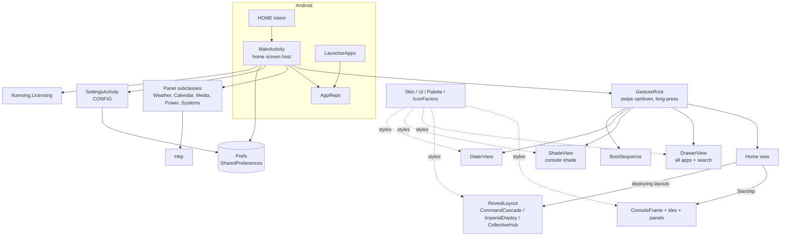
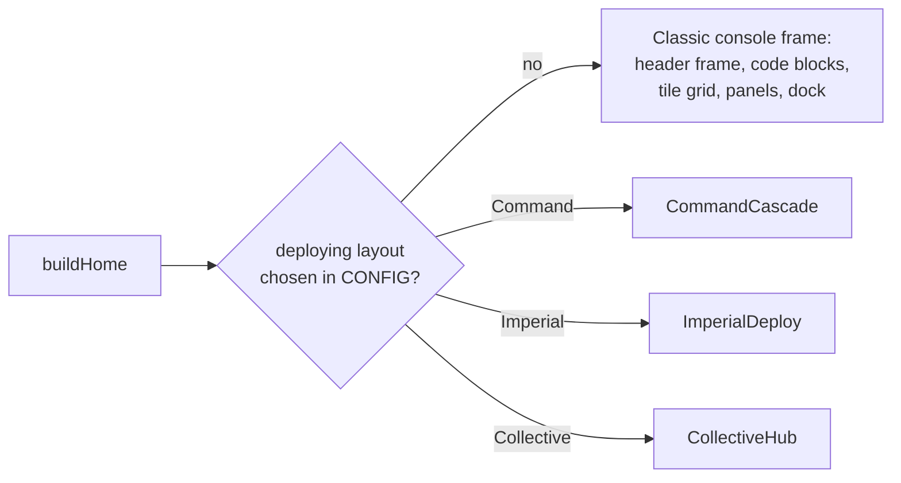
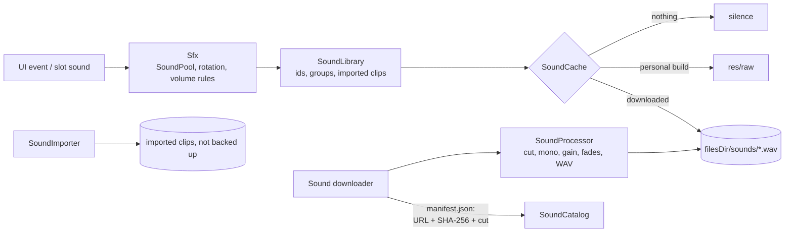
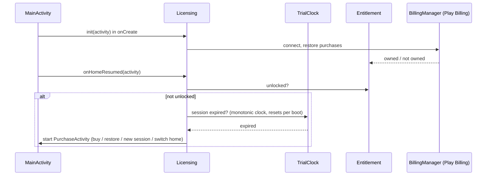

# Architecture

TrekUI Launcher is one Android application module (`:app`, package `com.gungreeneyes.trekui`) on top of the shared library `:core`, next to the three companion apps (`:messages`, `:keyboard`, `:lockscreen`). It is written in Kotlin against the Android framework (sources in `<module>/src/main/kotlin/`), with only a few AndroidX libraries (core, activity, window) and Play Billing. Compose, coroutines and DataStore are planned (phases 5 and 6 of [KOTLIN_PORT.md](KOTLIN_PORT.md)); today the code uses the same views, executors and `SharedPreferences` as the Java edition it was converted from.

There are **no XML layouts and no fragments**. Every screen is built in code from `View`/`ViewGroup` subclasses and `Drawable`s that paint themselves on a `Canvas`. That is how one codebase can render five visually distinct interfaces: the same view tree is decorated by whichever interface ("skin") is active.

> Class names below are current at the time of writing. Small helpers come and go, but the shape described here is stable. The code itself is the reference: every class carries a KDoc comment saying what it is and how it fits.

## Kotlin conventions in this codebase

The conversion from Java kept behaviour and shape, so the Kotlin follows a few patterns worth knowing before reading the code:

- **Static helpers are `object`s.** Former all-static classes are Kotlin `object`s: `Skin`, `Ui`, `ConsoleDialog`, `SubThemes`, `Era`, `Sfx`, `SuiteContract`, `SuiteClient` and `Licensing` in `:core`; `HomeLogic`, `SettingsLogic`, `LayoutArchive`, `IconFactory`, `Http`, `WidgetSlots`, `RedAlertLogic`, `HomeGestures` and `AppGroups` in `:app`. Classes with instances and a static factory keep a private constructor and a `companion object` (`Palette`, `ScreenMetrics`, `SoundCatalog`, `Prefs`, `AppRepo`).
- **`@JvmStatic` and `@JvmField`.** Many members still carry them from the mixed-language period, when Java callers had to keep compiling. They are harmless now. Keep them where a test looks a member up by name through Java reflection, where they must stay real static methods and fields with un-mangled names: the instrumented tests' `AppHooks` and `AppScenario` (`MainActivity.openConfig` / `requestDefaultHome` and its `drawer` field, `AppRepo.get`, the `Skin.faction` field, `Licensing.debugSetUnlocked` / `debugSetTrialSeconds`) and the Robolectric screenshot tests, which reset static fields by name between renders.
- **`internal` vs public.** Kotlin has no package-private visibility, and `internal` is per module. `:core` and `:app` share the package `com.gungreeneyes.trekui`, so what the Java code shared package-privately is now `public` in `:core` (`Skin`, `Ui`, `Palette`, `ConsoleFrame`, `ConsoleDialog`, `TrekPrefs`, …), while classes used only inside one app module are `internal` (in `:app`: `MainActivity`, `Prefs`, `AppRepo`, `Tile`, `Panel`, `Http` and most others; in the companions: the `MessagesLook`, `KeyboardLook` and `LockLook` facades). Tighten a `:core` declaration to `internal` only once every user is in `:core`.
- **Constants** are `const val` (in an `object` or a `companion object`); tables and nested-class fields that callers read directly are `@JvmField`.

## Big picture

## The home activity

`MainActivity` is the only `HOME` activity (`singleTask`, `clearTaskOnLaunch`, `excludeFromRecents`). Its life is a rebuild loop:

1. **`onCreate`**
   - Loads `Prefs` and the skin (`Skin.load`).
   - Starts `AppRepo`.
   - Wires licensing (`Licensing.init`).
   - Calls `buildUi()`.
   - Plays the start-up sequence once per boot, when enabled.
2. **`buildUi()`**
   - Tears down the current tree and builds a new `GestureRoot`, with the home view, `DrawerView`, `ShadeView` and `DialerView` stacked inside it (only the home view is visible).
   - Records `Prefs.version()` as the version this tree was built from.
3. **`onResume`**
   - Rebuilds the tree if the prefs version changed. `SettingsActivity` calls `Prefs.bump()` after any change that affects the home, so CONFIG never has to talk to the home directly.
   - Resumes the panels.
   - Tells licensing the home is in front.
4. **`onPause`** pauses every `Panel`, so nothing polls while another app is in front.
5. **Window insets** (status bar, navigation bar and display cutout) are read in `readInsets` and applied as padding in `applyInsets`, so the layout is edge-to-edge on every API level.

`buildHome()` chooses the home builder from the interface and the CONFIG layout:

### Slots, tiles and functions

- **Slots.** Every interactive element on the home screen is a *slot* with a string key: tiles, dock slots, elbows, bar segments, code blocks, titles, the clock and the date. `bindSlot` / `runSlot` / `editSlot` in `MainActivity` give each slot the same behaviour in every interface:
  - **Tap:** runs the assigned app or function, or the element's default behaviour.
  - **Long-press:** opens a menu to assign an app or function, rename, recolour, set a sound, or reset.
- **`Tile`.** Describes what a tile or dock slot launches: an app (component plus user), a console function (drawer, search, config, shade, dialer, cloak, `LIGHTS:` Govee device, `CLIMATE:` Nest device, `HA:` Home Assistant entity, …), or nothing.
- **`HomeLogic`.** Holds the pure decisions behind the home screen, so they are unit-testable.
- **App groups (OPEN GROUP).** `AppGroups` stores named app sets as one JSON array in the `group.list` pref (pure encode/parse/edit functions). A `Tile` with action `group` and the group id as `arg` opens `GroupPanel`, an overlay added to the home root that unfolds in the interface's style (Command spine cascade, Imperial deploy grid, Collective orbit), sized with `ScreenMetrics` inside the insets. `GroupEditor` holds the create / apps / reorder / rename / move / delete dialogs used from the home screen, the drawer's ADD TO GROUP and CONFIG › APP GROUPS.
- **Gestures.** `MainActivity.GestureRoot` offers every touch to `HomeGestureDetector` first. It recognises double-tap (only on empty space), two-finger swipes, pinch and horizontal swipes on the bare home screen, and runs the `Tile` stored under `gesture.<id>` (see `HomeGestures`, which also holds the thresholds). A gesture with nothing assigned is never taken, so the fixed swipe up (drawer) and swipe down (shade) behave as before. `GestureSettings` builds the CONFIG › GESTURES pickers.
- **LOCK SCREEN.** `LockScreen` runs the function through `LockService`, an optional `AccessibilityService` with no event types and no window access that only performs `GLOBAL_ACTION_LOCK_SCREEN` (API 28+). Play's prominent disclosure (`LockScreen.showDisclosure`) comes before Accessibility settings; see `docs/PLAY_STORE.md`. No Device Admin.

### Deploying layouts

`RevealLayout` is the base class of the press-to-deploy homes (`CommandCascade`, `ImperialDeploy`). `CollectiveHub` behaves the same way and implements the same `RevealHost` contract. A deploying home:

- starts folded down to one master control, deploys on a tap and folds again on the next;
- folds by itself after an app launches;
- always fits the space it is given, without scrolling.

Behind the **INFO** key, the panels appear as small keys (`RevealInfo`) or Collective nodes (`CollectiveInfo`). Tapping one opens that panel over the dimmed layout (`showHubPanel`). **STATIONS** opens `Stations`, the six simulated bridge consoles.

### Panels

`Panel` is the base class of the live home widgets: `WeatherPanel`, `CalendarPanel`, `MediaPanel`, `PowerPanel` and `SystemsPanel`. It has a `resume()` / `pause()` contract, and work happens only in between. The supporting classes are:

- **Readers:** `SysStats` (CPU, memory), `Weather` (Open-Meteo client), `MediaListener` (the notification-listener service: authorises reading media sessions, feeds the shade's notification log and the in-memory unread counts behind `NotificationBadges`), `SegBar` (level bars).
- **Card chrome:** `ConsoleCard` draws the bracketed frame around a panel in the active skin.
- **Hosted Android widgets:** `WidgetPanel` shows another app's widget inside a `ConsoleCard`. Its panel id is `appwidget<slot>`, so `Prefs.widgetOrder()` (through `WidgetSlots.panelIds`), HIDE PANEL, CONFIG › PANELS and the hub info nodes treat it like a built-in panel. `WidgetSlots` holds the pure logic: the `"slot:appWidgetId"` map in Prefs, the next free slot, orphaned ids and the row/height/dp size math (unit-tested). `WidgetHost` wraps the `AppWidgetHost` (host id `0x4C43`); `MainActivity` owns one and calls `startListening()` in `onStart` and `stopListening()` in `onStop`. Its views (`WidgetHost.ConsoleHostView`) show a console error notice instead of Android's grey box. `WidgetPickActivity` is the translucent add flow: provider list across all profiles → `bindAppWidgetIdIfAllowed`, else `ACTION_APPWIDGET_BIND` → `startAppWidgetConfigureActivityForResult` when the provider needs configuring → save the slot and `bump()`. Any cancel deletes the allocated id; a fresh start deletes ids no slot references. The laid-out size is sent with `AppWidgetHostView.updateAppWidgetSize` (a `SizeF` list on API 31+, min/max dp before) whenever the widget area's size changes.

## Interfaces (skins)

The interface is an `int` in `Skin.faction`:

| Value | Interface | Family | Home builder |
|---|---|---|---|
| 0 | Command | Starship | ConsoleFrame / CommandCascade |
| 1 | Imperial | Starship | ConsoleFrame / ImperialDeploy |
| 2 | Collective | Starship | ConsoleFrame / CollectiveHub |
| 9 | Classic Console (23rd-century style) | Starship (Command era) | ConsoleFrame / CommandCascade |
| 10 | Next Console (25th-century style) | Starship (Command era) | ConsoleFrame / CommandCascade |

Ids 3–8 are retired. A saved choice of one of them reads as Command (sub-theme 0), in the launcher and in the companion apps that read the launcher's theme row.

`Skin.command()` is true for 0, 9 and 10, so the eras reuse every Command code path; `Skin.era()` / `era23()` / `era25()` pick the era drawing. CONFIG lists the starship family in `SettingsLogic.STARSHIP_FACTIONS` order (0, 9, 10, 1, 2).

### Drawing vocabulary

| Class | Role |
|---|---|
| `Skin` | Current interface, palettes per interface, shape `Drawable`s for Imperial/Collective (`Chamfer`, `NodeCell`, `NodeNet`, `TacticalDisplay`), asset folders per interface |
| `Ui` | Shared helpers: dp/sp conversion with the responsive zoom, the spacing scale (HAIR 2 · XS 4 · GUTTER 6 · S 8 · M 12 · L 16 · XL 24 dp), fonts per interface, cloak state |
| `Palette` | The six Command colour themes (CLASSIC is the default) plus per-interface palettes; six accents used in rotation. `Palette.themesFor(faction)` / `Palette.of(faction, index)` is the one sub-theme lookup; Imperial and Collective palettes also carry chrome tones (bg, surface, grid, detail, ink) |
| `SubThemes` (`:core`, LCA-T35) | Pure `#RRGGBB` specs of every interface's sub-themes: Command 11 (0-5 the original themes, 6-10 DEEP BLUE .. MODERN GRAY), Imperial 5, Collective 5, eras from `Era`. `count` / `clamp` / `name` / `accents` are public for companions; `SuiteContract.parseTheme` clamps with it. Index 0 is always the original look. `TrekPrefs.palette()` calls `Skin.useSubTheme`, which points `Skin.imperialTheme` / `collectiveTheme` and `ImperialDraw.RED/ORANGE/YELLOW/DEEP` at the active Imperial / Collective theme, so `Skin.bg/surface/grid/detail/ink/glow` and the faction drawing follow it. Stored per interface under `TrekPrefs.themeKeyFor` (`theme`, `theme1`, `theme2`, `theme9`, `theme10`) |
| `ConsoleFrame` | The Command frame (elbows, bars, segments) and its Imperial/Collective counterparts; reports taps on each part to slots |
| `ImperialDraw`, `CollectiveDraw` | Faction-specific primitives (octagon plates, triangle rows; glowing nodes, traces, `TraceColumn`) |
| `Era`, `EraDraw`, `EraBoot` | The 23rd/25th-century Command eras: pure theme specs, contrast, lamp-blink and cut-corner rules (`Era`, unit-tested); console keys with blinking lamps, glass cells, frame corners, card brackets, icon frames, clock ornaments and CONFIG previews (`EraDraw`, reached from `Ui.shape/outline`, `ConsoleFrame`, `ConsoleCard`, `CommandCascade`, `IconFactory`); start-up sequences (`EraBoot`, from `BootSequence`). Themes: `Palette.ERA23` / `ERA25`, stored per era as `theme9` / `theme10` |
| `IconFactory` | App icons in the active style: console pictograms, framed icons, faction badges, or native icons |
| `Pictograms`, `IconPacks`, `IconPackParser`, `IconPicker` | Icon customisation (LCA-T22): the 109-name pictogram catalogue and package/label keyword table (`Pictograms`, pure); icon-pack discovery through the `<queries>` theme intents, `appfilter.xml` / `drawable.xml` parsing (`IconPackParser`, pure) and the raw-icon swap inside `AppRepo`'s background load, with backplate/mask composition for uncovered apps (`IconPacks`); the drawer's CHANGE ICON dialog (`IconPicker`). Per-app choices are `appIcon.<key>` prefs (`glyph:`, `pack:`, `app`); `iconPack` and `autoGlyphs` hold the CONFIG choices. Glyph art: the core 28 from `tools/legacy/make_glyphs.py`, the extended set from `tools/art/glyphs_extra.py`, rendered by `glyph_render.py` |
| `Starfield` | Background drawn once into a bitmap |
| `ConsoleDialog` | Every menu and prompt, drawn in the active skin (no platform `AlertDialog` look) |

## Other screens

| Class | What it is |
|---|---|
| `DrawerView` | All-apps drawer: search, category filter, long-press app menu (shortcuts, add to home or dock, hide, uninstall, app info) |
| `AppRepo`, `AppInfo` | Installed-app catalogue from `LauncherApps`, including work profiles. Live updates go to `AppRepo.Listener` (the activity) |
| `ShadeView` | console shade: toggles, brightness and volume, notification log (via `MediaListener`) |
| `NotificationActions` | REPLY (RemoteInput) and action keys under shade notifications; the console reply panel |
| `NotificationBadges` | Unread counts per app from `MediaListener`, drawn as a per-interface badge on each tile / hub node / dock key's overlay (`attach` hook in each home builder, `refresh` on change) |
| `DialerView` | Keypad with T9 contact matching, recents and contacts. Places a call with `ACTION_CALL` when allowed, otherwise hands the number to the phone app |
| `BootSequence` | The starship start-up sequences |
| `Stations` | Six simulated bridge consoles (`Ops`, `Conn`, `Tactical`, `Engineering`, `Science`, `Medical`) |
| `Cloak` | Timed night mode. `Cloak.Receiver` ends it from an alarm |
| `RedAlert`, `RedAlertLogic`, `RedAlertOverlay` | RED ALERT mode: state in Prefs, pure state machine/timeouts/pulse (JVM-tested), the pulsing per-interface frame with MUTE / STAND DOWN that MainActivity adds on top of every home tree. The klaxon loops through `Sfx.loopEvent(E_RED)`; `RedAlert.Receiver` is the backup stand-down alarm |
| `QsTiles`, `CloakTileService`, `RedAlertTileService` | Quick Settings tiles; `QsTiles.refresh` re-reads them when Cloak or RED ALERT change, `QsTiles.requestAdd` is CONFIG's API 33+ add-tile prompt |
| `ThermostatDialog`, `Nest` | Climate control; `ThermostatDialog.Backend` is a Nest device or a Home Assistant climate entity |
| `HomeAssistant`, `HomeAssistantDialog` | Home Assistant REST (`/api/states`, `/api/services/…`): entity import, tile taps, the light / switch / scene panel; address and token in the private `trekui_ha` preferences (excluded from backup and export) |
| `Govee` | Govee lights: LAN discovery (UDP multicast 239.255.255.250:4001, replies on 4002, commands to 4003) with the Govee cloud API as a fallback |
| `Http` | The only HTTPS client: refuses plain HTTP (except `requestAllowingLocalHttp` to `.local` / `.home.arpa` names for Home Assistant, mirrored by `res/xml/network_security_config.xml`), sets timeouts, caps reply size, runs on a background executor |
| `StatusWidget`, `QuickWidget` | Widgets for other launchers |
| `SettingsActivity` | CONFIG: one scrolling page with sections (INTERFACE, COLOR THEME, HOME LAYOUT, APP DRAWER, CHRONOMETER, WEATHER, AUDIO SYSTEMS, SMART DEVICES, NOTIFICATION SHADE, APP THEMING, DEFAULT HOME, ABOUT, …) |
| `PhoneSounds` | Exports a clip as the ringtone, notification or alarm sound |
| `Onboarding` | The first-run tour: one `ConsoleDialog` panel redrawn per stop, so it takes the interface's frame and key names (`Skin.nav`). `MainActivity.onResume` calls `Onboarding.maybeStart` (after the default-home welcome); CONFIG's REPLAY TOUR sets `tourReplay` and finishes |
| `LayoutArchive` | The layout as versioned JSON (`format: trekui-layout`, `schema`, typed `prefs`). `isExcluded` keeps credentials, device-bound and transient keys out of every file and untouched on apply; `parse` validates and `migrate`s (schema 0 = a flat prefs dump); `clearMissingApps` empties slots for apps not installed. Pure and JVM-tested |
| `LayoutSnapshots` | Automatic snapshots in `filesDir/layouts/` (`yyyyMMdd-HHmmss-SSS_reason.json`, newest 10 kept, duplicates skipped). `checkUpgrade` in `MainActivity.onCreate` snapshots on a versionCode change; CONFIG snapshots before reset, interface switch, import and restore |
| `LayoutBackupUi` | CONFIG › BACKUP flows: SAF export (`ACTION_CREATE_DOCUMENT`) and import (`ACTION_OPEN_DOCUMENT`), preview / APPLY, UNDO LAST CHANGE, SNAPSHOT NOW, RESTORE. Reads and writes on a worker thread |

## Sounds

- **No recordings ship with the app.**
  - `SoundCatalog` reads `assets/sounds/manifest.json`. For each sound id, it gives where the original is publicly downloadable, its SHA-256 checksum and how to cut it.
  - The downloader fetches the originals when the user asks, verifies them and renders them with `SoundProcessor`.
  - `SoundCache` resolves an id to a downloaded clip, to a `res/raw` clip (only in personal develop builds made from the gitignored `personal_sounds/`), or to silence.
- **Imports.** `SoundImporter` turns user files or ZIPs into clips. `SoundPicker` is the two-step group/sound chooser.
- **Playback.** `Sfx` plays clips. It respects silent mode, calls and the touch-sounds setting.

[docs/SOUNDS.md](SOUNDS.md) covers the catalogue in detail.

## Settings and persistence

- **`Prefs`** (`:app`, an `internal` subclass of `:core`'s `open class TrekPrefs`) is one shared instance (`Prefs.get(context)`, from its `companion object`) over `SharedPreferences("trekui")`. It stores the interface, palette, tiles, dock, slot assignments, panel order, the weather location mode, and the device credentials the user enters (Govee API key, Nest OAuth tokens).
  - Any change that alters the home calls `bump()`, and the home rebuilds on its next resume.
- **CONFIG › SUITE** (LCA-T35, `SettingsActivity.suiteSection` + `SuiteSettings`): KEYBOARD (active input method, `InputMethodManager.showInputMethodPicker`, the enable screen), LOCK SCREEN (`TrekPrefs.lockscreenEnabled`, key `suiteLockscreen`, published on the suite provider's additive `lockscreen` path; `SuiteClient.launcherLockscreenEnabled` reads it) and MESSAGES (default SMS: `Telephony.Sms.Intents.ACTION_CHANGE_DEFAULT` up to Android 9, `SuiteContract.ACTION_REQUEST_SMS_ROLE` sent to TrekUI Messages on 10+ since `RoleManager` only requests roles for the caller; falls back to the default-apps screen; the previous SMS app is kept in `suitePrevSms` for RESTORE). INSTALL opens `SuiteContract.marketUri` / `playUrl`. Picking a sub-theme or flipping LOCK SCREEN calls `SuiteProvider.notifyChanged` so running companions re-read at once.
- **Licensing state** has its own store (`licensing.PrefsKeyValueStore`).
- **Layout files and snapshots** (`LayoutArchive`, `LayoutSnapshots`) cover the `trekui` prefs minus credentials, device-bound and transient keys. Applying one replaces those layout keys, leaves the excluded ones alone and calls `bump()`.
- **Backups.** Android Auto Backup covers the prefs. Imported and downloaded sound files are excluded (`res/xml/backup_rules.xml`, `data_extraction_rules.xml`).

## Licensing

`com.gungreeneyes.trekui.licensing` lives in `:core` (`core/src/main/kotlin/com/gungreeneyes/trekui/licensing/`) and is self-contained, so all four apps share it. `MainActivity` calls only `Licensing`, a Kotlin `object` whose entry points are `@JvmStatic`.

- **Sessions:** the length is `BuildConfig.TRIAL_SESSION_MINUTES`: 720 (12 hours) in both flavors.
- **Product:** `BuildConfig.UNLOCK_PRODUCT_ID` = `trekui_unlock`.
- **Interruptions:** the purchase screen only ever replaces the home screen, never another app.

Design notes are in [docs/MONETIZATION.md](MONETIZATION.md).

## Responsive layout

`ScreenMetrics.of(context)` is the one source of truth for sizing. It provides:

- Material 3 width and height size classes;
- `marginPx()` and `gutterPx()`;
- `uiScale`: the short side relative to a 360 dp phone, clamped to 0.85–1.6;
- `columns(minTileDp, min, max)`;
- `isTwoPane()`, `isTall()` and `isLandscape()`.

Layout code asks `ScreenMetrics` instead of hard-coding pixel sizes, column counts or orientation. The orientation lock is gone, and every screen must work in portrait and landscape, from small phones to tablets, on folded and unfolded foldables, and in multi-window. The maths is in a pure `compute` function and is unit-tested.

## Threading

- **Main thread:** all view work runs here, and the Imperial and Collective drawing helpers share one `Paint` on the UI thread.
- **Background executors:** network calls (`Http`), Govee sockets, sound downloads and decoding, and app loading. Results are posted back to the main thread.
- **Visibility:** panels refresh only between `resume()` and `pause()`.
- **No background services:** the app has none, apart from the notification listener, which Android binds only when the user grants notification access.

## Build-time structure

- **Flavors:** `develop` (`.dev` suffix, "TrekUI Dev", 12-hour trial) and `production` (`com.gungreeneyes.trekui`, "TrekUI"). See [BUILD.md](BUILD.md).
- **Sources:** Kotlin only, in `src/main/kotlin/` of each module, compiled by AGP 9's built-in Kotlin support (JVM target 17). Tests are in `src/test/kotlin/` and, for the launcher's instrumented scenarios, `app/src/androidTest/kotlin/`.
- **Assets:** generated by the scripts in `tools/` (Python and Node). Generated output is committed under `core/src/main/assets/` (fonts, glyphs, sounds) and `app/src/main/assets/` (faction badges, quick-panel and app-theme art, wallpapers), so building needs no Python.

## Companion app: TrekUI Messages (`:messages`)

A separate application module (`com.gungreeneyes.trekui.messages`, same flavors and signing as `:app`) that depends only on `:core`. It is a complete default SMS/MMS app: Telephony provider reads/writes (`MessageStore`, `MmsStore`), `SmsManager` SMS and MMS sending with status receivers, its own MMS PDU codec (`mms/PduCodec`), notifications with inline reply, `BlockedNumberContract` blocking and dual-SIM choice. Screens extend `BaseScreen` and draw through `com.gungreeneyes.trekui.MessagesLook`, an `internal object` facade (in the `:messages` module, same package as `:core`'s `Ui`, `Skin`, `Palette`, `ConsoleFrame`, `ConsoleDialog`; those were package-private in Java and are public in Kotlin, which has no package-private visibility, and the facade keeps the companion's screens on one narrow surface). It follows the launcher's interface/sub-theme via `SuiteClient.launcherTheme` → `TrekPrefs.setThemeOverride`, registers `SuiteProvider` for the shared unlock, and answers the launcher's `SuiteContract.ACTION_REQUEST_SMS_ROLE` in `RequestRoleActivity`. Details: [MESSAGES.md](MESSAGES.md).

## Companion app: TrekUI Keyboard (`:keyboard`)

A separate application module (`com.gungreeneyes.trekui.keyboard`, same flavors and signing as `:app`) that depends only on `:core`. `TrekKeyboardService` (an `InputMethodService`, subtypes per language in `res/xml/method.xml`) hosts one Canvas view, `KeyboardView`, that paints the suggestion strip and the keys with the interface's own cell drawables through `com.gungreeneyes.trekui.KeyboardLook` (the same `internal object` facade pattern as `MessagesLook`). The decisions are pure and unit-tested in `keyboard/logic`: `Layouts` (page tables per language), `ShiftState`, `Alternates`, `FieldRules` (input type → page, enter action, the incognito rule), `Suggestions`, `WordEdit`, `Sizing`. Learned words live in `WordStore` (`noBackupFilesDir`), the personal dictionary is read from `UserDictionary`. It follows the launcher's interface via `SuiteClient.launcherTheme` → `TrekPrefs.setThemeOverride` (`KeyboardTheme`, throttled), registers `SuiteProvider`, and runs licensing only in `KeyboardSettingsActivity`; the IME shows an UNLOCK chip instead of ever blocking input. The merged manifest has no `INTERNET` permission. Details: [KEYBOARD.md](KEYBOARD.md).

## Companion app: TrekUI Lock Screen (`:lockscreen`)

A separate application module (`com.gungreeneyes.trekui.lockscreen`, same flavors and signing as `:app`) that depends only on `:core`. `LockListener` (a `NotificationListenerService`) is both the data source and the trigger: while bound it registers a dynamic `SCREEN_ON` / `SCREEN_OFF` / `USER_PRESENT` receiver, feeds the filtered, redacted notification list into `LockHub` (memory only) and observes the launcher's `lockscreen` suite path. On a screen-on, `WakeTrigger` (enabled via `EnableRule`, keyguard showing, no call, 1.5 s debounce) starts `WakeActivity`, a `showWhenLocked` activity whose one Canvas view, `WakeView`, draws the frame, clock, decimal date, media keys, list and actions through `com.gungreeneyes.trekui.LockLook` (the `internal object` facade pattern again) and exposes its controls through an `AccessibilityNodeProvider`. Every exit goes through `KeyguardManager.requestDismissKeyguard`; nothing runs behind the keyguard until it succeeds. `SettingsActivity` is the launcher entry, the setup flow and the only place licensing runs. Pure rules live in `lockscreen/logic` (`DecimalDate`, `Redaction`, `EnableRule`, `WakeTrigger`) with JVM tests. No foreground service, AccessibilityService or Device Admin. Details and Play policy reasoning: [LOCKSCREEN.md](LOCKSCREEN.md).
