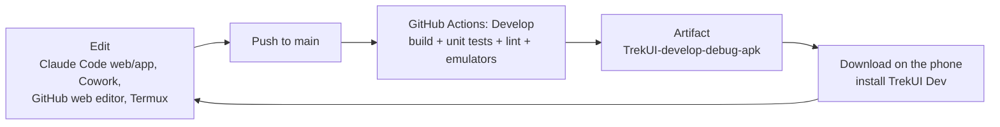

# Developing from anywhere

You don't need a desktop with Android Studio to work on TrekUI Launcher. GitHub Actions builds a fresh APK on every push to `main`, so this loop works from a phone:



The develop build installs as **TrekUI Dev** (`com.gungreeneyes.trekui.dev`), next to any store copy. To try it, press Home and pick TrekUI Dev.

## 1. Claude Code on the web and in the Claude phone app

Claude Code can run as a cloud session against the GitHub repository. You start and steer it from claude.ai in a browser, or from the Claude app on your phone.

1. **Connect the repository.** Connect GitHub to Claude, and grant access to `GunGreenEyes/TrekUI.Java`.
2. **Start a session** on the repository and describe the change. Mention the ticket if there is one (`LCA-T<n>`).
   - Claude reads [CLAUDE.md](../CLAUDE.md) and [AGENTS.md](../AGENTS.md) automatically. They hold the build commands, the conventions (`ScreenMetrics`, no copyrighted audio, ticket prefix) and where tests and media go.
3. **Expect no local build.** The cloud sandbox normally has no Android SDK or emulator, so Claude cannot run `./gradlew` there. CI is the build machine. `bash scripts/setup.sh --skip-build` can install a JDK and SDK into the sandbox if its network policy allows downloads from `dl.google.com`. That makes JVM unit tests possible, but it is slow and not required.
4. **Let the session push** its commits, or open a PR. Then ask it to check CI:

   ```sh
   gh run list --workflow Develop --limit 3
   gh run watch <run-id>
   gh run view <run-id> --log-failed        # when something fails
   ```

5. **Install the result** (see section 3).

Tips:

- **Keep sessions small.** One ticket per session.
- **Before you merge,** ask for a summary of what changed and which tests were added.
- **For layout work,** ask Claude to look at the screenshots from the `capture-*` artifacts or the Pages site after CI runs. That is the only way it can "see" the UI from the cloud.
- **Pushes that only touch `docs/` or `*.md` don't build an APK.** That is by design.

## 2. Cowork

Cowork (Claude's desktop agent for longer, multi-step work) can work against a local clone or the GitHub repo with the same project guide.

- **Delegate whole tickets.** For example: "LCA-T12: make the drawer two-pane on tablets, add a scenario and a unit test, push, and report the CI result."
- **Give it a folder with the clone.** If that machine has the toolchain (run `scripts/setup.*` once), Cowork can build and run unit tests locally before pushing.
- **The rules are the same as for any agent.** They are in [AGENTS.md](../AGENTS.md): explicit `git add <paths>`, commit messages starting with the ticket ID, and no secrets or audio.

## 3. Getting the APK onto the phone

**From a CI run (any push to `main`):**

1. In the GitHub app or a mobile browser, open **Actions › Develop** and the newest successful run.
2. Download the **TrekUI-develop-debug-apk** artifact. You need to be signed in, and artifacts are kept for 14 days.
3. Open the downloaded zip and tap the APK inside.
   - Some file managers can't open a zip; Files by Google and Samsung My Files can.
   - Allow "install unknown apps" for that app the first time.

**From a release:** download `TrekUI-<version>.apk` from **Releases**. That is the production build, `com.gungreeneyes.trekui`.

**With `gh` (from Termux or a computer):**

```sh
gh run download --repo GunGreenEyes/TrekUI.Java --name TrekUI-develop-debug-apk --dir ~/trekui-apk
# then on Termux: termux-open ~/trekui-apk/*.apk ; on a computer: adb install -r ~/trekui-apk/*.apk
```

> APKs signed with different keys can't update each other. If an install fails with "conflicts with an existing package", uninstall the old TrekUI Dev first.

## 4. Building on the phone with Termux

The original developer built the launcher on the phone itself with [Termux](https://termux.dev). Install Termux from F-Droid or GitHub; the Google Play version is outdated. Then:

```sh
pkg update && pkg install git
git clone https://github.com/GunGreenEyes/TrekUI.Java && cd TrekUI.Java
bash scripts/setup.sh
```

`scripts/setup.sh` detects Termux and:

- installs `openjdk-21`, `git`, `gh`, `python`, `nodejs-lts`, `ffmpeg`, `aapt`/`aapt2` and `android-tools` (adb) with `pkg`;
- downloads the Android command-line tools to `~/android-sdk` and installs `platforms;android-37.0` and `build-tools;37.0.0`;
- writes `android.aapt2FromMavenOverride=$PREFIX/bin/aapt2` to **`~/.gradle/gradle.properties`**. The SDK's own aapt2 is an x86_64 binary that can't run on an ARM phone. The setting is per-machine and never goes in the repo. The script also caps the Gradle heap at 2 GB there;
- writes `local.properties` and runs `./gradlew assembleDevelopDebug`.

Install the result on the same phone:

```sh
termux-setup-storage                                         # once: lets Termux use shared storage
cp app/build/outputs/apk/develop/debug/*.apk ~/storage/downloads/
termux-open ~/storage/downloads/app-develop-debug.apk        # opens Android's installer
```

Notes:

- **Emulators don't run on Termux.** The phone is the test device. Instrumented tests need adb: enable **Wireless debugging** in Developer options, `adb pair` and `adb connect` to the phone itself from Termux, then run `./gradlew connectedDevelopDebugAndroidTest`.
- **Builds are slow.** The first build downloads Gradle and the dependencies, which takes several minutes. Keep the screen on, or run `termux-wake-lock`.
- **If resource linking fails** after an AGP upgrade, the Termux aapt2 may be too old. Run `pkg upgrade aapt`, or fall back to CI.
- **Pushing from Termux.** `gh auth login` once, then `git push`. CI then builds the "official" APK for you.

## 5. The GitHub web editor

For small text changes you can edit directly on github.com: press `.` on the repo page for github.dev, or use the pencil icon. Examples are a string, a colour or a doc. Commit to `main` (or a branch and PR), and CI builds the APK as above.

## Where to look when something fails

| What | Where |
|---|---|
| Build or unit-test failure | Actions run › **Build, unit tests, lint** job log; artifact `unit-test-reports` |
| Lint warnings | artifact `lint-report` |
| UI looks wrong | artifacts `capture-robolectric` and `capture-<device>-api<N>` (screenshots and video), or the [Pages site](https://gungreeneyes.github.io/TrekUI.Java/) after a release |
| Instrumented test failure | artifact `androidTest-report-<device>-api<N>` (includes logcat, with Given/When/Then steps under the `TREKUI-GHERKIN` tag) |
